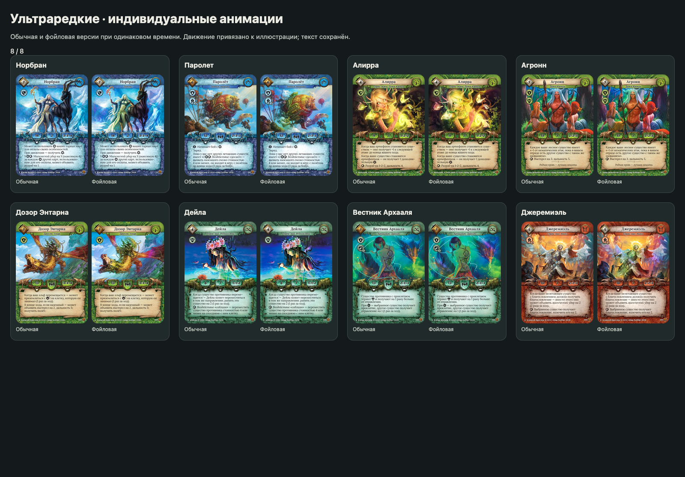

# Unique card animations

99 card identities: 26 ultra-rares from the supplied collection export, all
24 ultra-rares and all 49 rares from «Сердце роя». Each card received its own
sub-agent for artwork inspection and effect implementation or review.

Every effect is time-driven, with a separate `u_is_foil` metallic/iridescent finish.
Reduced motion freezes the animation while keeping foil visible. Full pointer
3D tilt remains. Original scan pixels outside each illustration mask are preserved.

These shaders are authored against base artwork and used by its ordinary and foil
editions. Different alternate/full-art illustrations retain their existing finish;
variants without their own scan reuse the matching base-art effect. The collection
scope contained base/shared-art variants. No collection quantities or purchase
prices are stored in this document or the test fixture.

## Collection cards

| Card | Animation | Source |
| --- | --- | --- |
| Харседан | Twin whip charges, horse highlights and charging dust. | [50020](../src/shaders/unique/card_50020.frag) |
| Казагир | Soth breastplate mark, glowing engravings and a two-stage sword charge. | [50034](../src/shaders/unique/card_50034.frag) |
| Медный дракон | Mouth-fed fire squall, breathing heat and copper wing highlights. | [50035](../src/shaders/unique/card_50035.frag) |
| Нересса | Staff and palm spell wells, nightmare trails and falling sparks. | [50090](../src/shaders/unique/card_50090.frag) |
| Эйдерик | Two resurrection wakes, grave fire, spectral eyes and raised-weapon charge. | [50161](../src/shaders/unique/card_50161.frag) |
| Лилит | Three tribute streams converge on the skull chalice; throne and jewel glow. | [50170](../src/shaders/unique/card_50170.frag) |
| Тёмный епископ | Opposing blessing and curse streams flow from the palms into the sword. | [50175](../src/shaders/unique/card_50175.frag) |
| Падшая Линнет | Palm-fed discharge follows painted fire arcs, with embers and crown reflections. | [50192](../src/shaders/unique/card_50192.frag) |
| Орк-ведун | War-drum heartbeat, charged crook, feather shimmer and expanding sky rings. | [60020](../src/shaders/unique/card_60020.frag) |
| Эр-Мариб | Charged palms and painted fire rays; flames rise from the golem impact wounds. | [60034](../src/shaders/unique/card_60034.frag) |
| Сейвар | Borrowed-life motes gather beneath the palm; cyan runes and staff pulses. | [60054](../src/shaders/unique/card_60054.frag) |
| Кром Железный | Formation signals travel between the dwarves’ weapons and Krom’s layered armor. | [60069](../src/shaders/unique/card_60069.frag) |
| Фенке | Five mace charges trigger an undead phase with green eyes and poison wisps. | [60074](../src/shaders/unique/card_60074.frag) |
| Надзиратель Бик | Paired retaliatory wound pulses feed strength into brass ornaments and claws; breath. | [60094](../src/shaders/unique/card_60094.frag) |
| Темный друид | Grave spores and life-in-decay tendrils feed the corpse and staff flame. | [60106](../src/shaders/unique/card_60106.frag) |
| Магистр Шарль | Red potion bubbles and escaping vapor; green staff current and spores. | [60180](../src/shaders/unique/card_60180.frag) |
| Дух Адрелиана | Three companion souls send cyan tethers into the emerald heart; spectral hand and eyes. | [60182](../src/shaders/unique/card_60182.frag) |
| Хигарт Несокрушимый | Wind-driven snow, red cloak highlights, axe glint and deflected-impact arcs. | [60218](../src/shaders/higart.frag) |
| Арзель | Jeweled-staff discharge reaches the palm while embers rise from painted flames. | [70010](../src/shaders/unique/card_70010.frag) |
| Гару | Lunar corona, moonlight along the raised arm and three snow-crossing wakes. | [70073](../src/shaders/unique/card_70073.frag) |
| Лазурный дракон | Freezing breath and shards reach the castle; raised-claw ice orb and wing light. | [70074](../src/shaders/unique/card_70074.frag) |
| Куссума | Violet spirit and dagger flow, ruby pulses and three forest rot marks. | [70093](../src/shaders/unique/card_70093.frag) |
| Вейде Вечная | Three elm-leaf guardians, crown-bound energy and a protective arm halo. | [70109](../src/shaders/unique/card_70109.frag) |
| Адепт Уггуда | Skull-staff energy feeds a four-cell astral net over the dragon’s glowing bones. | [70169](../src/shaders/unique/card_70169.frag) |
| Аль-Фаграз | Drifting clouds behind the citadel, paired bridge pulses, glowing windows and rising garden healing motes. | [70206](../src/shaders/unique/card_70206.frag) |
| Владычица Алетрис | Three wing-to-staff charges, flame tongues and emerald landing rings. | [70211](../src/shaders/unique/card_70211.frag) |

## Сердце роя — ultra-rare cards

| Card | Animation | Source |
| --- | --- | --- |
| Халия | Reverse-running staff clock, paired lightning and returning spell fragments. | [80012](../src/shaders/unique/card_80012.frag) |
| Гуго Ван Дер Верт | Three charges cross the cuffs and hands before a central discharge. | [80022](../src/shaders/unique/card_80022.frag) |
| Полководец Холверта | Blade glint, orders traveling through the ranks and defensive shoulder arcs. | [80029](../src/shaders/unique/card_80029.frag) |
| Матриарх Дегаска | Brazier essence, three fang marks, fire and lightning. | [80035](../src/shaders/unique/card_80035.frag) |
| Норбран | Four icy reservoirs feed the staff; hoof wakes and branching discharge. | [80055](../src/shaders/unique/card_80055.frag) |
| Лафей | Seven ice-chain links run from the hand to the captive; frost and ice chips. | [80056](../src/shaders/unique/card_80056.frag) |
| Паролет | Twin rotors, steam, boiler pressure and airborne deployment wakes. | [80068](../src/shaders/unique/card_80068.frag) |
| Рангхильда | Three cyan charges travel from whip through arm and mantle to dagger. | [80069](../src/shaders/unique/card_80069.frag) |
| Алирра | Diamond-to-butterfly artifact change, palm motes and forked discharge. | [80078](../src/shaders/unique/card_80078.frag) |
| Крысиная королева | Charged fan ribs, spinning fan echoes and retinue-to-regalia motes. | [80090](../src/shaders/unique/card_80090.frag) |
| Агронн | Paired leaf wards, synchronized motes and bow release. | [80091](../src/shaders/unique/card_80091.frag) |
| Дозор Энтарна | Dragon scales and wing currents; landing seal feeds leaves and arrow. | [80109](../src/shaders/unique/card_80109.frag) |
| Дейла | Flower-and-finger lure, paired river wakes, water and hair reflections. | [80119](../src/shaders/unique/card_80119.frag) |
| Грых | Leaf and spore streams feed the mouth; swallowing, moss and insects. | [80128](../src/shaders/unique/card_80128.frag) |
| Обольстительница | Magic packets exchange places through the river; fingertip-to-lotus discharge. | [80142](../src/shaders/unique/card_80142.frag) |
| Вестник Архааля | Dragon-mouth venom, cursed diamond talisman and eroding ward fragments. | [80146](../src/shaders/unique/card_80146.frag) |
| Легион | Molten ribs, sword flames, retaliatory embers and teleportation ash. | [80174](../src/shaders/unique/card_80174.frag) |
| Виз | Blessing and curse exchange across horns, wings and hand seals. | [80176](../src/shaders/unique/card_80176.frag) |
| Король Элмор | Shield cysts, crown-bound rot spores and double-sickle energy. | [80180](../src/shaders/unique/card_80180.frag) |
| Магистр Фарро | Four Coven charges feed the clasp and opposing palm spells. | [80183](../src/shaders/unique/card_80183.frag) |
| Джеремиэль | Solar crown, feather light and two blessings reaching the foreground warriors. | [80199](../src/shaders/unique/card_80199.frag) |
| Кайна Наварро | Red scarf flutter, sabre sheen, gulls and a rocking recruitment die. | [80200](../src/shaders/unique/card_80200.frag) |
| Гартас | Segger seal, banner highlights, lion eyes and fist embers. | [80205](../src/shaders/unique/card_80205.frag) |
| Маэстро Зунрак | Marionette strings and paired soul transfers from the fallen double. | [80213](../src/shaders/unique/card_80213.frag) |

## Сердце роя — rare cards

| Card | Animation | Source |
| --- | --- | --- |
| Сагырма | Desert gusts, swaying palm crowns, heat shimmer and rising sand along the pilgrim’s path. | [80001](../src/shaders/unique/card_80001.frag) |
| Око Сота | Rotating jade eye, reincarnation orbits, expanding halo and coil-fed lightning. | [80003](../src/shaders/unique/card_80003.frag) |
| Лимастра | Healing ribbons join the hand and cat’s mane; green flank wards and returning petals. | [80013](../src/shaders/unique/card_80013.frag) |
| Машинный червь | Cyan siphons feed the head; copper packets cross the segments, with mouth sparks and a travel wake. | [80017](../src/shaders/unique/card_80017.frag) |
| Аримас | Forward-fist shockwaves, flying stones and cyan tattoo charges. | [80021](../src/shaders/unique/card_80021.frag) |
| Делиома | Palm-to-branch lightning, three protective crescents and rising flame trails. | [80028](../src/shaders/unique/card_80028.frag) |
| Фурс | Amber command pulses follow the whip and flying creature; creatures breathe amid air streaks. | [80030](../src/shaders/unique/card_80030.frag) |
| Трибун | Wind moves the cape, a sword command flashes, and three hoof shockwaves spread through dust. | [80037](../src/shaders/unique/card_80037.frag) |
| Сердце мира | Glacier streaks, paired charges climbing the monolith, rune pulses, fortress ward and snow. | [80038](../src/shaders/unique/card_80038.frag) |
| Верафьора | A rotating shield catches a projectile; charge crosses the aura and becomes a redirected discharge. | [80051](../src/shaders/unique/card_80051.frag) |
| Охотящийся дракон | Rising wind rings wrap the perch and talons, with ascending motes and moving wing highlights. | [80053](../src/shaders/unique/card_80053.frag) |
| Минотавр Лантшилда | Shield impact rings and retaliatory sparks, paired axe crescents and windblown snow. | [80057](../src/shaders/unique/card_80057.frag) |
| Архимаг Дхайа | Traveling lightning packets follow the painted bolts; three aligned discharge rings and casting sparks. | [80060](../src/shaders/unique/card_80060.frag) |
| Хродгар | Tankard steam and amber droplets rise while paired table-edge pulses redistribute the impact. | [80064](../src/shaders/unique/card_80064.frag) |
| Королева наг | Four sequential sword sweeps, crown motes and flowing moonlit water. | [80070](../src/shaders/unique/card_80070.frag) |
| Лавовый гигант | Molten pulses descend shield fissures into branching lava rivers; embers rise through shoulder fire. | [80074](../src/shaders/unique/card_80074.frag) |
| Чащобина | Sap climbs the tall tree, leaves tumble upward, and healing rings spread through the roots. | [80076](../src/shaders/unique/card_80076.frag) |
| Брэнг Одноглазый | Musket charge, shot, powder-smoke rings and traveling embers with a redirected ricochet. | [80085](../src/shaders/unique/card_80085.frag) |
| Крысполин | Branch pressure wakes and torn leaves, with a breathing giant and sequential snarling-head highlights. | [80094](../src/shaders/unique/card_80094.frag) |
| Ильмара | Green and gold sparks travel along the painted familiars; currents cross the flowing scarf. | [80098](../src/shaders/unique/card_80098.frag) |
| Глас Кронга Воймир | Cyan magic converges on the palm, golden spells return, and broken ward rings expand through forest wind. | [80104](../src/shaders/unique/card_80104.frag) |
| Циклоп-чернокнижник | Violet discharge follows the painted shadow, palm rings expand, and the single eye charges amber. | [80106](../src/shaders/unique/card_80106.frag) |
| Деор | Leaves converge on the raised weapon, charge travels through the haft, and an amber strike crescent sweeps beside Deor. | [80107](../src/shaders/unique/card_80107.frag) |
| Злободрев | Three rot-draining currents converge on the burning maw, with rising embers, pulsing eyes and root sap. | [80110](../src/shaders/unique/card_80110.frag) |
| Трясины Исхара | Poison ripples expand across five painted pools, with rising bubbles and curling marsh fumes. | [80116](../src/shaders/unique/card_80116.frag) |
| Ксанто | A flapping moth spell travels from the raised hand across the gorge above flowing waterfalls. | [80124](../src/shaders/unique/card_80124.frag) |
| Гидра Гворна | Three poison streams leave the mouths, swamp ripples move, and regeneration climbs the central neck. | [80126](../src/shaders/unique/card_80126.frag) |
| Умбаган | Broad water wakes and arcing spray follow the forelimbs, with paired copper companion bolts from the bow. | [80131](../src/shaders/unique/card_80131.frag) |
| Тиша | Poison highlights travel along two curved daggers, with falling droplets and localized vapor. | [80141](../src/shaders/unique/card_80141.frag) |
| Тролль-похититель | Green lure wisps and capture trails connect prisoner and lantern; regeneration crosses the gripping arm. | [80144](../src/shaders/unique/card_80144.frag) |
| Манаан | Bubbles rise beside the mount; staff charges release three spectral tridents through moving water caustics. | [80145](../src/shaders/unique/card_80145.frag) |
| Карбагаш | Surfacing bubbles, a retracting tongue lash, traveling ice-blade glint and skin caustics. | [80148](../src/shaders/unique/card_80148.frag) |
| Дракхроу | Three plague-smoke ribbons emerge from city alleys, with rising spores and flickering windows. | [80149](../src/shaders/unique/card_80149.frag) |
| Имаго | Four insect wings flutter with traveling cyan bands; rot spores drift outward beneath the elf and charge crosses the scythe. | [80154](../src/shaders/unique/card_80154.frag) |
| Кан-Кауран | Spectral cloak tails and spirit motes drift around an ascending sword charge and expanding shield stasis rings. | [80160](../src/shaders/unique/card_80160.frag) |
| Мормолика | Crimson vampire ribbons feed the hand; cyan discharge grows from raised claws through drifting forest fog. | [80164](../src/shaders/unique/card_80164.frag) |
| Энши | Three crimson vitality streams connect the undead heads to raised hands, with traveling knots and palm pulses. | [80166](../src/shaders/unique/card_80166.frag) |
| Роунда | A hand-commanded insect swarm crosses scarlet root-corruption pulses and flowing turquoise mist. | [80168](../src/shaders/unique/card_80168.frag) |
| Кровавый дракон | Blood offerings climb into the jaws, crimson waves cross the wings, and blue energy pulses through the chest. | [80169](../src/shaders/unique/card_80169.frag) |
| Кадавр | Three electrode charges feed the reaching palm, branching discharges and electric chair arcs. | [80185](../src/shaders/unique/card_80185.frag) |
| Искаженные земли | Three elemental trails cross the foothills beneath curling clouds, climbing mountain light and rainbow glints. | [80187](../src/shaders/unique/card_80187.frag) |
| Эктор | Healing steam and motes rise from the feast, with flickering candles and glowing goblet and pendant. | [80197](../src/shaders/unique/card_80197.frag) |
| Палач Сеггера | A burning Segger seal moves across the axe amid bending fire tongues and rising cinders. | [80201](../src/shaders/unique/card_80201.frag) |
| Проклятый адмирал | Skull-pauldron curse ribbons, paired armor pulses, a pistol tracer and rising ship embers. | [80203](../src/shaders/unique/card_80203.frag) |
| Ангел Милосердия | Golden feather currents, protective trails around the embrace and blessing sparks from the hand. | [80206](../src/shaders/unique/card_80206.frag) |
| Путающий следы | Cloak-edge wind and flowing folds, fading leap traces from the boots and a thrown kunai. | [80209](../src/shaders/unique/card_80209.frag) |
| Рулевой | Six tailwind ribbons, sea spray and ripples surround twin bronze charges orbiting the wheel. | [80214](../src/shaders/unique/card_80214.frag) |
| Дракон Хаоса | Six wound and healing currents alternate around wing-spar pulses and chest scale waves. | [80216](../src/shaders/unique/card_80216.frag) |
| Канонир | Torch flames and ember trails rise beside periodic cannon flashes and curling powder smoke. | [80220](../src/shaders/unique/card_80220.frag) |

## Rendering and verification

The [registry](../src/card_effects.rs) selects effects by set and card number.
Programs compile on demand in one WebGL context and are reused between editions.
A failed individual shader does not disable the other cards.

`tests/card_effects.rs` checks requested scope coverage, every set-80 rare and ultra-rare,
ordinary/foil identity matching, alternate-art protection and unique registration.
`scripts/test_unique_shaders.py` compiles each GLSL program in isolated Firefox,
compares moving frames, toggles foil at identical time, checks static reduced-motion
output, and verifies protected text at full and compact size. New rare effects
also require clearly changing pixels at 128px width. It saves per-card
captures and paginated ordinary/foil proof sheets to `/tmp/ultra-shader-captures/`.
`scripts/test_foil_firefox.py 1600 unique` checks all 198 base/foil surfaces in the
application and recovery after WebGL context loss.

See [foil rendering](foil.md) for lifecycle, fallback, and known Firefox 3D
compositing limitations.

## Visual reference

Static samples at identical time: ordinary on the left, foil on the right.

